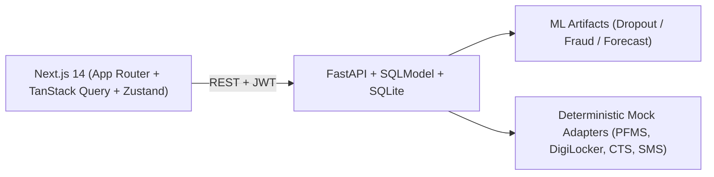

# Vidya Pragati Setu

**Offline-first Gujarat Scholarship & Bicycle Logistics Platform (PS000044)** — student eligibility discovery, multi-scheme applications, school/DEO verification, bicycle logistics, mock PFMS DBT tracking, and next-year renewal simulation across six demo roles in Gujarati, English, and Hindi.

## Architecture



## Quick Start

### 1. Full Stack (Production Next.js Build + FastAPI + Seeded SQLite)
```bash
make demo-reset   # Reset seeded SQLite snapshot (1,500 students, 40 schools)
make demo         # Starts FastAPI (:8000) + Next.js production build (:3000)
```

### 2. Offline Mock Backup (No Backend Required)
```bash
make demo-offline
```
The command builds and starts the frontend with local mock data at `http://localhost:3000` (or `VPS_WEB_PORT`).

## Demo Logins (OTP: `123456`)

| Role | Identifier | Mobile |
|---|---|---|
| Student (Riya Patel) | `GJ-AND-2026-004512` | `9876543210` |
| School Principal | `SCH-AND-001` | `9898000001` |
| Taluka Officer (TPEO) | `TPEO-BOR-001` | `9898000002` |
| District Education Officer (DEO) | `DEO-AND-001` | `9898000003` |
| State Admin | `ADMIN-STATE-001` | `9898000004` |
| Cycle Vendor | `VND-001` | `9898000005` |

## What's Real vs. Mock

- **Real (SQLite + FastAPI + JWT)**: Auth/OTP, role-scoped RBAC, eligibility evaluation, document upload + OCR storage, 1-click bulk apply, school/DEO approval workflow, vendor batch dispatch & school handover, PFMS DBT sanction/initiate, next-year student promotion diff, and audit logs.
- **Mock Adapters (`ADAPTER_MODE=mock`)**: External government integrations (PFMS, Aadhaar/UIDAI, CTS, DigiLocker, SMS, LLM). ML models (`api/artifacts/*.joblib`) are trained on synthetic demo data.
- **UI Wiring**: 17 Tier 1 routes are wired to FastAPI (`P2`, `P3`, `S1`, `S2`, `S4`, `S5`, `S6`, `S7`, `S8`, `S10`, `SC2`, `SC3`, `SC5`, `D2`, `A3`, `V1`, `X1`). X1 currently wires promotion and eligibility diff; its attendance simulation, DBT simulator, and reset controls are not implemented in the UI. Tier 2/3 screens remain fixtures or static; they are not real-data dashboards yet.

## Verification & QA

```bash
make test            # Backend pytest + ruff + Web tsc + lint
make check-contract  # 80 endpoint calls across six seeded roles
make e2e             # Playwright Golden Path, 3 fresh-database runs
make qa               # Contract, backend/frontend checks, production build, auth smoke, 33 screenshots
```

See [`docs/DEMO_SCRIPT.md`](docs/DEMO_SCRIPT.md) for the walkthrough, [`docs/STATUS.md`](docs/STATUS.md) for per-screen API wiring and browser coverage, and [`docs/FINAL_STATUS.md`](docs/FINAL_STATUS.md) for verified evidence and remaining limitations. No hosted demo URL is currently verified.

## License
[MIT](LICENSE)
